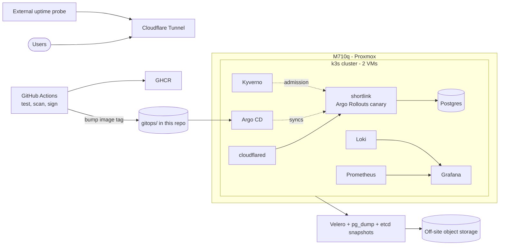

# homelab-platform

A Kubernetes platform I'm building on a single mini PC at home (Proxmox + k3s) and running with real users.

**Status:** just started (November 2026). This page only claims what has evidence linked.

## Goal

Run one small public service (a link shortener) the way a small platform team would: GitOps delivery with canary releases, SLO-based alerting, signed images and admission policy, and backups with a tested restore. Keep it running for months and write up what breaks.

## Hardware

Lenovo ThinkCentre M710q (Core i5-7500, 16 GB RAM, 256 GB SSD). Proxmox host with a two-VM k3s cluster.

## Target architecture

> Target design. Not built yet.

## Progress

| Milestone | Status | Evidence |
|---|---|---|
| Proxmox and k3s cluster built from code | not started | |
| App deployed through Argo CD | not started | |
| Canary release with automatic abort | not started | |
| SLO with burn-rate alerts | not started | |
| Signed images and admission policy | not started | |
| Restore drill with measured RPO/RTO | not started | |
| Same setup on AWS EKS (time-boxed) | not started | |

## Known limitations

- **One physical host.** Two VMs on one machine are not high availability. A dead PC takes everything down.
- **Availability is bounded by home power and my ISP,** so it is measured by an external probe, not from inside the cluster.
- **AWS is a time-boxed run,** not a permanent environment.
